<div align="center">

# 🎬 Vidance

**中文一句话 → 有声短片，一条命令**

*LLM 编剧 → 视频生成 → 边生边审 → TTS 配音 → 剪辑特效 → 成片*


<a href="./docs/assets/poster.jpg">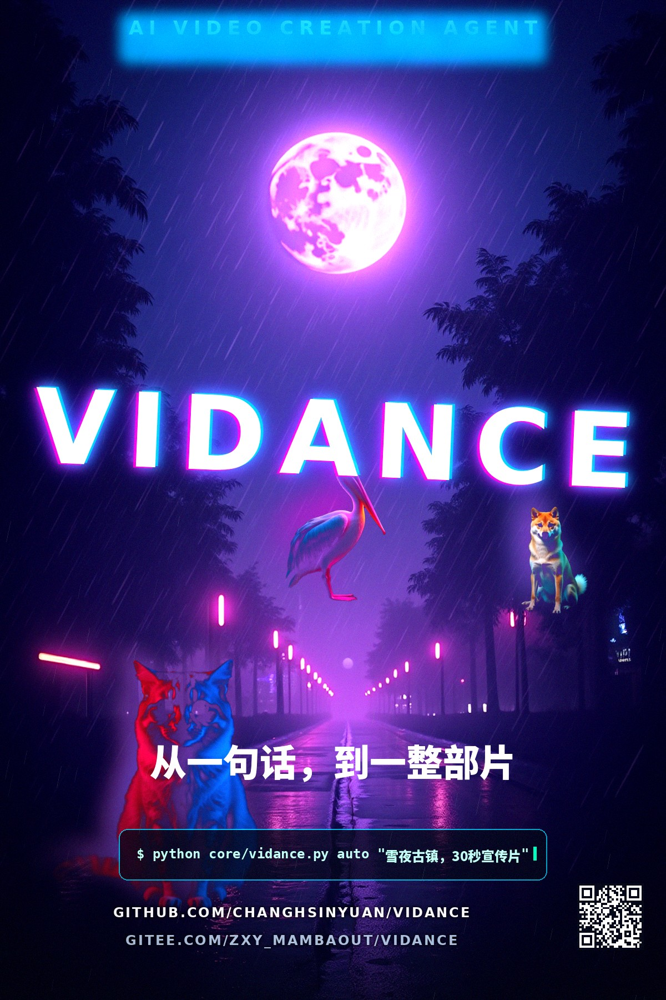</a>
<a href="./docs/assets/poster-alt.jpg">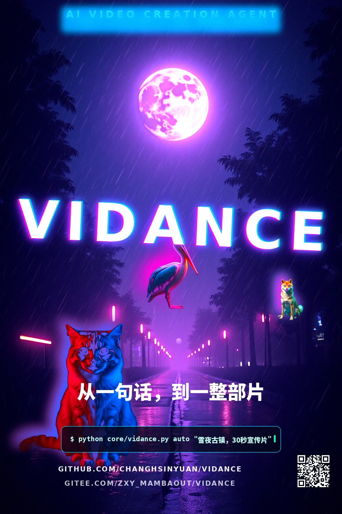</a>


[快速开始](#-快速开始) · [效果演示](#-效果演示) · [系统架构](#️-系统架构) · [五档部署](#-五档能力矩阵) · [文档](#-文档索引)

**无 GPU 的笔记本也能出片；有 4 卡就是全家桶。**

</div>

---

## ✨ 核心特性

| | |
|---|---|
| 🎬 **全链路自动生成** | LLM 编剧 → FLUX 关键帧 → Wan2.2 I2V → 逐镜审片重试 → RIFE 插帧 → TTS 配音 → BGM 混音 → 字幕烧录，一条命令出片 |
| 👀 **边生边审** | 生成过程中实时抽取 latent 预览帧丢给多模态模型粗审，画面崩坏立即中断止损换 seed，不浪费整段生成时间 |
| 📦 **五档部署** | 同一份代码，`VIDANCE_TIER` 一个环境变量收放能力——无 GPU 机器也能跑 SVG 动画和爬图营销号链路 |
| ✂️ **编辑全家桶** | SAM2 分割/抠图/打码/换底 + YOLO 自动检测 + FLUX Fill 重绘 + VACE 参考图生视频 + 指令式编辑（"把猫换成狗"） |
| 🔁 **视频链接二创** | 丢一个 B 站/YouTube 链接 → 下载理解 → LLM 改写解说词（防复述）→ 重配音 → 画面改写，还能消除原片烧录字幕 |
| 🧩 **多形态输出** | 有声短片 / 营销号图文快剪 / SVG 动画 / LLM 生成 PPT（mp4+PDF+PNG）/ Blender 3D / 宣传海报（LLM 规划+FLUX+SAM 自动合成）/ 小说一键改编成片 |
| 🤖 **多智能体编排** | 导演/生成/后期/审片四层 28 个 Agent，chain 编排 + 黑板共享 + 全轨迹可视化 |
| 🗣️ **自然语言操控** | t2c 微调模型把中文口语直接翻译成 Vidance 命令，WebUI 里说话就能出片 |

## 🎬 效果演示

> 点击缩略图播放（GIF 之外的 demo 均为仓库内 mp4 直链）

| 全链路 auto（12s） | 电影感模板 | 国风水墨模板 |
|:---:|:---:|:---:|
| [](./docs/demo/auto-healing.mp4) | [](./docs/demo/template-cinematic.mp4) | [](./docs/demo/template-guofeng.mp4) |
| `auto "治愈系小短片"` | `auto "概念" --template cinematic` | `auto "概念" --template guofeng` |

| Wan T2V 直出 | SVG 动画（纯 CPU） | Blender 3D（纯 CPU） |
|:---:|:---:|:---:|
| [](./docs/demo/demo-wan.mp4) | [](./docs/demo/demo-svg.mp4) | [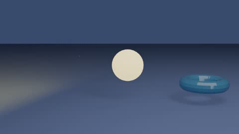](./docs/demo/demo-blender3d.mp4) |
| `quick "三只猫在草地奔跑"` | `svg --concept "小鸭子骑自行车"` | `blender3d "3D 几何演示"` |

| LLM 生成 PPT | SAM2 物体掩码 | 视频编辑 |
|:---:|:---:|:---:|
| [](./docs/demo/demo-ppt.mp4) | [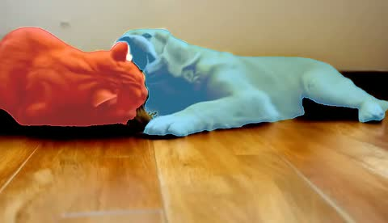](./docs/demo/demo-sam-mask.mp4) | [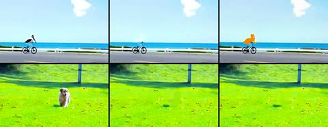](./docs/demo/demo-edit.mp4) |
| `ppt "主题" --video` | `edit video --op color` | `edit video --op mosaic` |

<div align="center">

### 🎥 全流程实录

**Agent 端到端跑完一次完整生成的屏幕实录**：从提交概念到出片全程记录，等待段已剪除并在右上角标注跳过时长（12.5 分钟 → 6 分钟）

[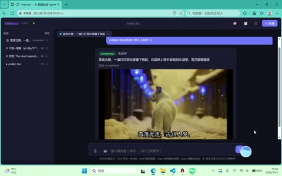](./docs/demo/demo-fullflow.mp4)

</div>

<div align="center">

### 🖼️ 产出全景

[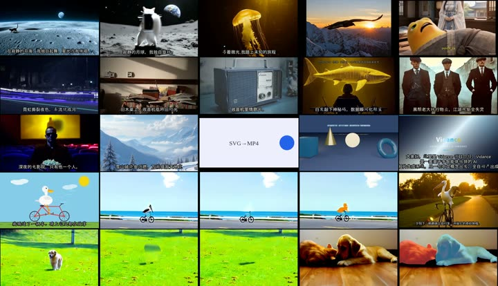](./docs/demo/demo-showcase.mp4)

**5×5 视频墙：一次看全 Vidance 的全部产出形态**（点击播放，无声 5s 循环）

</div>

## 🏗️ 系统架构

<div align="center">

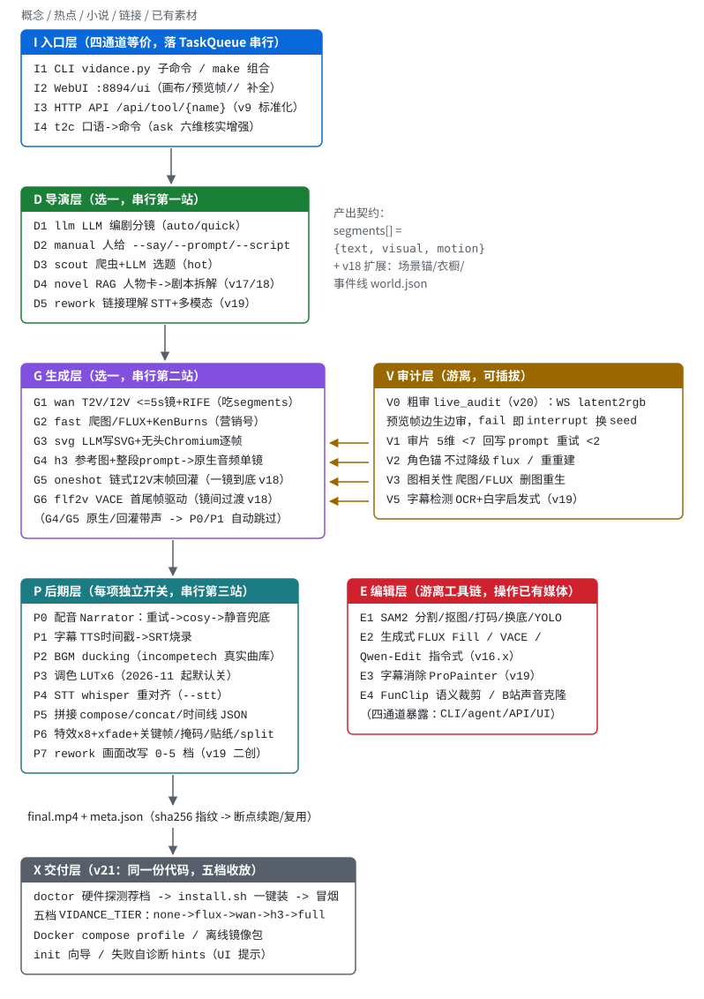

</div>

> 四通道入口（CLI/WebUI/API/自然语言）落同一任务队列；D→G→P 串行流水线，V 审计与 E 编辑双游离层；X 交付层按五档收放。详细设计见 [docs/design/hierarchy.md](./docs/design/hierarchy.md)。

## 🚀 快速开始

```bash
git clone <repo-url> && cd vidance

# 1) 一键安装：自动探测 GPU/磁盘/网络 → 推荐档位 → 起容器 → 冒烟验证
bash deploy/install.sh

# 2) 首次配置向导（LLM key / 音色 / 输出目录，逐项回车保留）
python core/vidance.py init

# 3) 出第一条片（无 GPU 也能跑：爬图 + Ken Burns + TTS）
python core/vidance.py fast "深夜便利店的一只橘猫" -n 3
```

浏览器打开 `http://<ip>:9400/ui` 即是 WebUI。

<details>
<summary>有视频卡？跑全链路 auto →</summary>

```bash
python core/vidance.py auto "雪山日出：小狐狸的冒险" --character "红色小狐狸" --character-mode flux

# 边生边审（生成中粗审，崩坏即止损）
python core/vidance.py auto "红狐狸雪原捕猎" --live-audit

# 一镜到底（链式 I2V 末帧回灌）
python core/vidance.py auto "穿越隧道的光" --oneshot --duration 30
```

</details>

<details>
<summary>其他安装方式（离线镜像包 / conda 裸机 / GPU 服务编排）→</summary>

见 **[deploy/README.md](./deploy/README.md)**：五档 Docker compose profiles、离线镜像交付（`dist/images/`）、conda 裸机路线。

</details>

## 📦 五档能力矩阵

| 档 | 硬件 | 能力 |
|----|------|------|
| `none` | 无 GPU | SVG 动画 + 爬图营销号链路 + edge-tts（在线） |
| `flux` | 1× 图像卡 | + SDXL/FLUX 生图 |
| `wan` | 1× 视频卡 | + Wan2.2 T2V/I2V + RIFE 插帧 + auto 全链路 + CosyVoice 本地 TTS |
| `h3` | 1× | + MiniMax-H3 参考图直出（custom/h3shot） |
| `full` | 多卡 | + Hunyuan3D 3D 锚点 + STT + 声音克隆，全家桶 |

- 档位定义：`config/tiers/*.json`；守卫：`/api/health` 报档位、`/api/tools` 按档过滤、能力不足直接提示
- **体检**：`vidance doctor` 探测 GPU/磁盘/网络并推荐档位；任务失败自动附诊断建议（端口/依赖/磁盘，UI 里 💡 提示）

## 🗺️ 功能全景

<details>
<summary>展开 9 条产品线 →</summary>

| 线 | 入口 | 说明 |
|----|------|------|
| 全链路生成 | `auto` | LLM 编剧 × 审片重试 × 五维模板（cinematic/documentary/anime90s/guofeng）× `--oneshot` 一镜到底 |
| 参考图直出 | `custom` / `h3shot` | 参考图 + 预写脚本 → H3 ref2va（原生带音频） |
| 营销号快剪 | `fast` / `hot` | 爬热点 → LLM 选题 → 爬图/FLUX 出图 → Ken Burns → TTS，跳过视频模型 |
| 链接二创 | `rework` | 视频 URL → 改写解说 → 重配音 → 画面改写 0-5 档 + 烧录字幕消除 |
| 视频编辑 | `edit` / `vace` | SAM2 分割/追踪 + FLUX Fill + VACE + 指令式编辑 |
| 多形态 | `svg` / `ppt` / `blender3d` | 纯 CPU 三线：SVG 动画 / LLM PPT（mp4+PDF+PNG）/ Blender 3D |
| 宣传海报 | `poster` | 概念→LLM 规划→FLUX 底板+SAM 抠图→PIL 排版合成（标题色散/辉光/雨夜氛围/终端卡/QR） |
| 小说改编 | novel2video | RAG 人物卡 + 剧本拆解 + 场景锚 + 衣橱系统 + 首尾帧驱动渲染 |
| 时间线 | `compose` / `concat` | 关键帧/贴纸轨/转场特效库（30+ xfade）/ RIFE 光流过渡 |
| 统一编排 | `make` / `agent` | director×generator 排列组合 + 28 Agent chain + `/api/agents` |

完整命令库：[docs/usage/usage.md](./docs/usage/usage.md)

</details>

## 🖥️ 界面一览

| WebUI 任务画布 | 多智能体编排 |
|:---:|:---:|
| 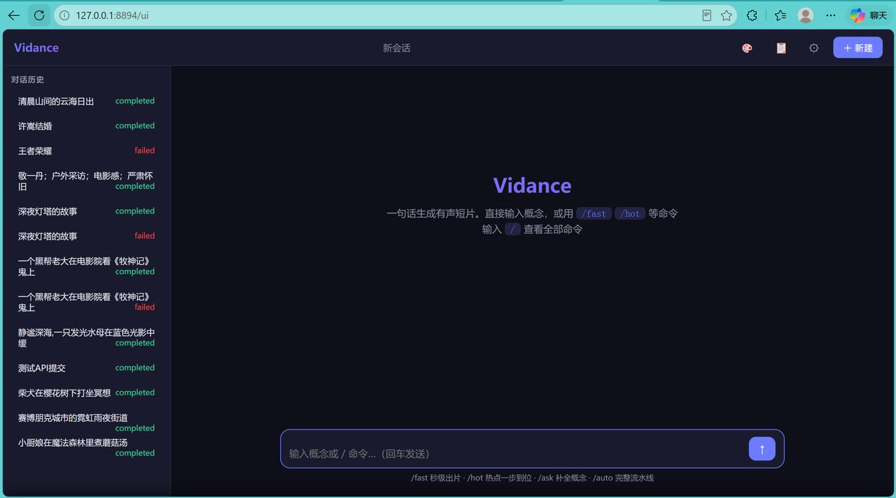 | 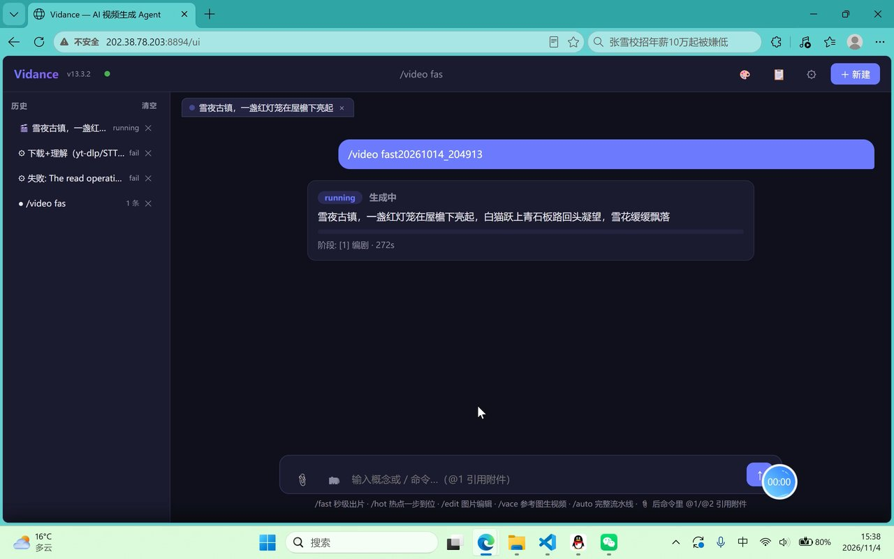 |
| **自然语言对话出片** | **SAM2 编辑（六宫格对比）** |
| 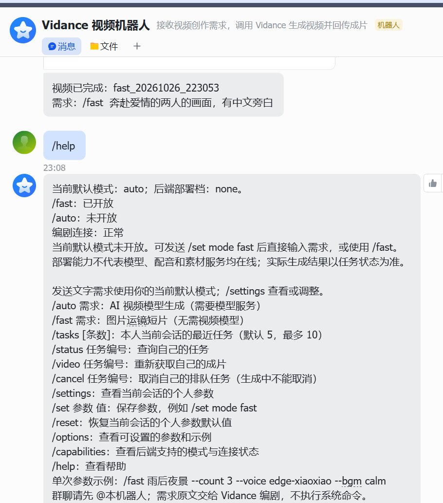 | 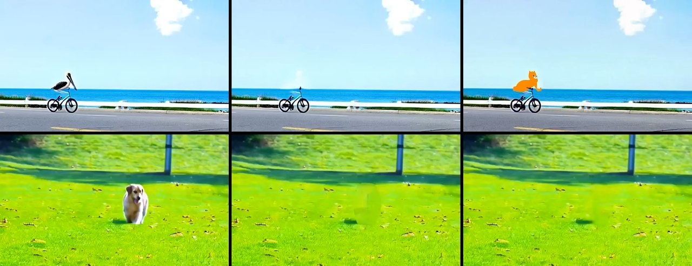 |

## 🧪 质量

- 17 套测试 ~400 项断言全绿（`python tests/test_<name>.py` 直跑）
- 关键约束自动化：随机 seed、单镜 ≤5s、时长对齐、Windows 兼容编码（h264 + yuv420p 全环节显式）
- 全程元数据落盘（meta.json：脚本/prompt/seed/审片分/时间戳），断点续跑带 sha256 指纹防篡改

## 📚 文档索引

| 文档 | 内容 |
|------|------|
| [docs/usage/usage.md](./docs/usage/usage.md) | 主使用手册（按档位快速上手 + 全命令） |
| [docs/roadmap.md](./docs/roadmap.md) | 完整版本路线（v0→v21 全部收官） |
| [CHANGELOG.md](./CHANGELOG.md) | 版本变更日志 |
| [deploy/README.md](./deploy/README.md) | 部署详解（五档/Docker/离线镜像/GPU 服务） |
| [docs/design/](./docs/design/) | 各版本设计文档（含架构图源文件 arch_v21.svg） |
| [AGENTS.md](./AGENTS.md) | Agent 开发约定（内部） |

## 🔒 配置与隐私

- `config/config.json` 入库的是**占位符模板**（`YOUR_*_API_KEY`），真实 key 放 `config/config.local.json`（已 gitignore，加载器自动优先读取）
- 首次配置用 `python core/vidance.py init` 向导写入，key 不会出现在日志里

## License

[Apache License 2.0](./LICENSE) —— 可商用/可修改/可闭源二次分发；贡献者代码附带明确专利授权。
