<div align="center">

English | [简体中文](./README.md)

# 🎬 Vidance

**One Chinese sentence → a narrated short film, in one command**

*LLM scriptwriting → video generation → generate-and-review → TTS dubbing → editing & VFX → final cut*

[](https://github.com/ChangHsinYuan/vidance/actions/workflows/ci.yml)


<a href="./docs/assets/poster.jpg">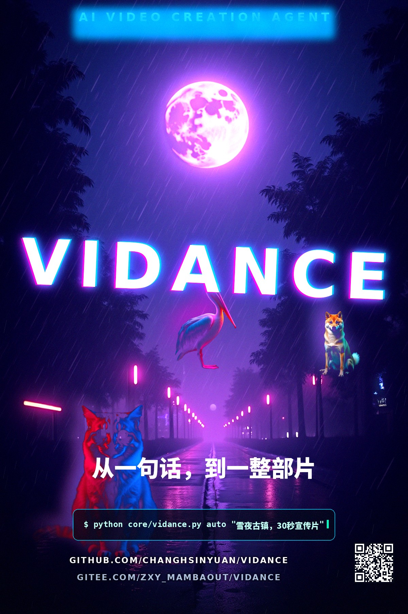</a>
<a href="./docs/assets/poster-alt.jpg">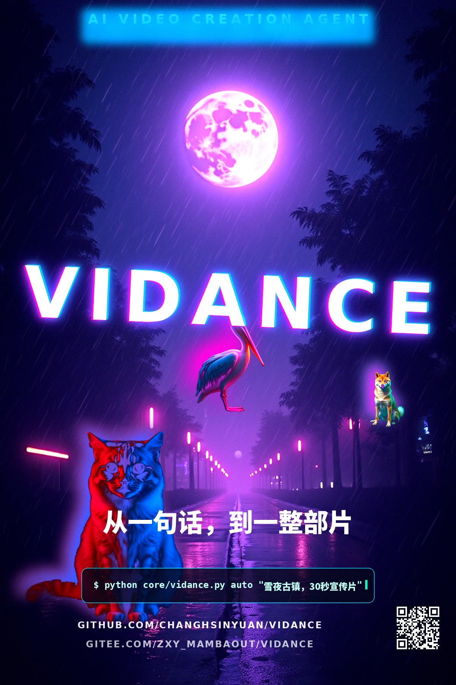</a>


[Quick Start](#-quick-start) · [Demos](#-demos) · [Architecture](#️-architecture) · [Five-Tier Deployment](#-five-tier-capability-matrix) · [Docs](#-documentation)

**Makes films even on a GPU-less laptop; with 4 GPUs you get the full suite.**

</div>

---

## ✨ Core Features

| | |
|---|---|
| 🎬 **Full-chain auto generation** | LLM scriptwriting → FLUX keyframes → Wan2.2 I2V → per-shot review with retries → RIFE interpolation → TTS dubbing → BGM ducking → burned-in subtitles — one command, one finished film |
| 👀 **Generate-and-review** | While generating, latent preview frames are pulled in real time and sent to a multimodal model for a rough pass; on visual collapse the run is interrupted at once and the seed swapped — no wasted generation time |
| 📦 **Five-tier deployment** | Same codebase, one `VIDANCE_TIER` env var scales capability up and down — a GPU-less machine still runs SVG animation and the crawled-image marketing line |
| ✂️ **Full editing suite** | SAM2 segmentation/matting/mosaic/background swap + YOLO auto-detection + FLUX Fill inpainting + VACE reference-image-to-video + instruction-based editing ("swap the cat for a dog") |
| 🔁 **Video-link rework** | Drop a Bilibili/YouTube link → download & understand → LLM rewrites the narration (anti-parroting) → re-dub → visual rewrite; can even remove burned-in subtitles |
| 🧩 **Multi-format output** | Narrated shorts / marketing-style slideshow cuts / SVG animation / LLM-generated PPT (mp4+PDF+PNG) / Blender 3D / promo poster (LLM planning + FLUX + SAM auto compositing) / one-click novel-to-film |
| 🤖 **Multi-agent orchestration** | 28 agents across four layers (direct / generate / post / audit), chain orchestration + shared blackboard + full trace visualization |
| 🗣️ **Natural-language control** | A fine-tuned t2c model translates spoken Chinese straight into Vidance commands — talk in the WebUI and get a film |

## 🎬 Demos

> Click a thumbnail to play (all demos except the GIF are direct in-repo mp4 links)

| Full-chain auto (12s) | Cinematic template | Guofeng ink-wash template |
|:---:|:---:|:---:|
| [](./docs/demo/auto-healing.mp4) | [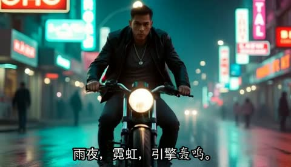](./docs/demo/template-cinematic.mp4) | [](./docs/demo/template-guofeng.mp4) |
| `auto "a healing little short"` | `auto "concept" --template cinematic` | `auto "concept" --template guofeng` |

| Wan T2V direct | SVG animation (pure CPU) | Blender 3D (pure CPU) |
|:---:|:---:|:---:|
| [](./docs/demo/demo-wan.mp4) | [](./docs/demo/demo-svg.mp4) | [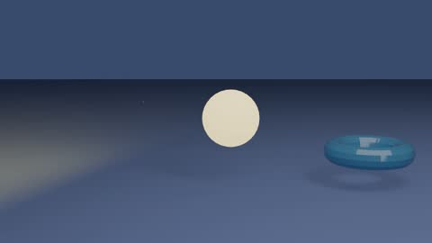](./docs/demo/demo-blender3d.mp4) |
| `quick "three cats running on grass"` | `svg --concept "a duckling riding a bike"` | `blender3d "3D geometry demo"` |

| LLM-generated PPT | SAM2 object masks | Video editing |
|:---:|:---:|:---:|
| [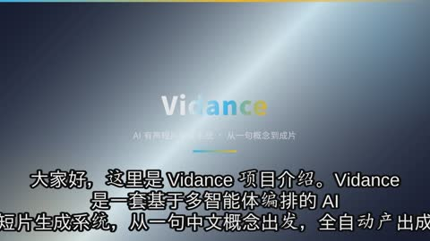](./docs/demo/demo-ppt.mp4) | [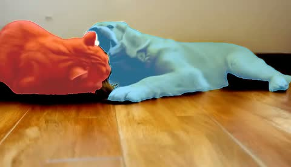](./docs/demo/demo-sam-mask.mp4) | [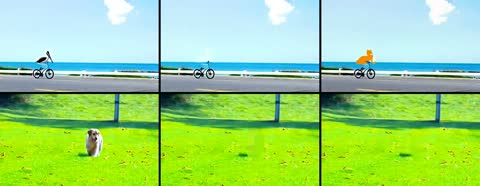](./docs/demo/demo-edit.mp4) |
| `ppt "topic" --video` | `edit video --op color` | `edit video --op mosaic` |

<div align="center">

### 🎥 Full-Flow Recording

**Screen recording of an agent running one complete generation end to end**: from submitting a concept to the finished film; waiting segments are cut out with the skipped time annotated top-right (12.5 min → 6 min)

[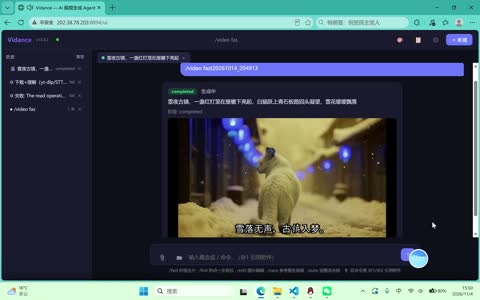](./docs/demo/demo-fullflow.mp4)

</div>

<div align="center">

### 🖼️ Output Panorama

[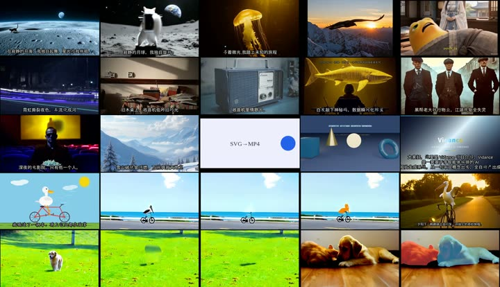](./docs/demo/demo-showcase.mp4)

**A 5×5 video wall: every output format of Vidance at a glance** (click to play, silent 5s loop)

</div>

## 🏗️ Architecture

<div align="center">

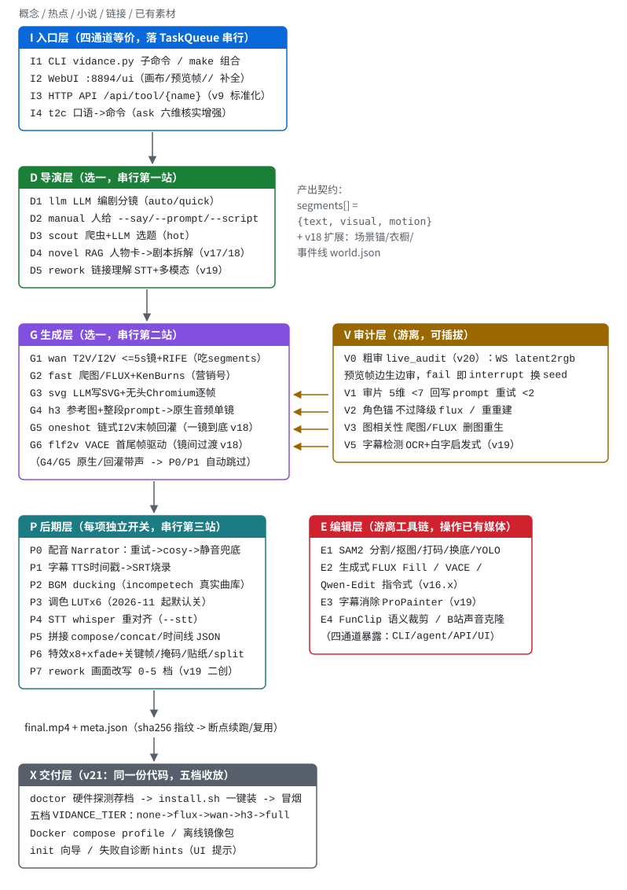

</div>

> Four entry channels (CLI / WebUI / API / natural language) feed one task queue; the D→G→P serial pipeline runs with V (audit) and E (edit) as detached side layers; the X delivery layer scales by tier. See [docs/design/hierarchy.md](./docs/design/hierarchy.md) for the detailed design.

## 🚀 Quick Start

**Route A: Cloud API (no GPU, first film in ~5 minutes)**

```bash
# 1) Run the published image directly (cloud LLM API + edge-tts online dubbing, pure CPU)
docker run -d --name vidance -p 9400:8894 \
  -e VIDANCE_TIER=none -e VIDANCE_PORT=8894 \
  -v $PWD/config:/app/config -v $PWD/output:/app/output \
  ghcr.io/changhsinyuan/vidance-api:latest

# 2) Config wizard to write your LLM key (press Enter to keep defaults)
docker exec -it vidance python core/vidance.py init

# 3) First film (image crawl + Ken Burns + TTS, no models needed)
docker exec vidance python core/vidance.py fast "an orange cat in a late-night convenience store" -n 3
```

Open `http://<ip>:9400/ui` in a browser for the WebUI; finished films land in the mounted `output/` dir.

**Route B: Clone the repo (includes GPU tiers)**

```bash
git clone <repo-url> && cd vidance

# 1) One-line install: auto-detects GPU/disk/network → recommends a tier → starts containers → smoke-tests
bash deploy/install.sh

# 2) First-run config wizard (LLM key / voice / output dir; press Enter to keep defaults)
python core/vidance.py init

# 3) First film (runs even without a GPU: image crawl + Ken Burns + TTS)
python core/vidance.py fast "an orange cat in a late-night convenience store" -n 3
```

Open `http://<ip>:9400/ui` in a browser for the WebUI.

<details>
<summary>Got a video GPU? Run the full auto chain →</summary>

```bash
python core/vidance.py auto "sunrise over snow mountains: a little fox's adventure" --character "a little red fox" --character-mode flux

# Generate-and-review (rough pass during generation; abort and swap seed on collapse)
python core/vidance.py auto "a red fox hunting on the snowfield" --live-audit

# One-shot single take (chained I2V with last-frame feedback)
python core/vidance.py auto "light passing through a tunnel" --oneshot --duration 30
```

</details>

<details>
<summary>Other install paths (offline image bundle / bare-metal conda / GPU service orchestration) →</summary>

See **[deploy/README.md](./deploy/README.md)**: five-tier Docker compose profiles, offline image delivery (`dist/images/`), and the bare-metal conda route.

</details>

## 📦 Five-Tier Capability Matrix

| Tier | Hardware | Capabilities |
|------|----------|--------------|
| `none` | No GPU | SVG animation + crawled-image marketing line + edge-tts (online) |
| `flux` | 1× image GPU | + SDXL/FLUX image generation |
| `wan` | 1× video GPU | + Wan2.2 T2V/I2V + RIFE interpolation + full auto chain + CosyVoice local TTS |
| `h3` | 1× | + MiniMax-H3 reference-image direct generation (custom/h3shot) |
| `full` | Multi-GPU | + Hunyuan3D 3D anchors + STT + voice cloning — the full suite |

- Tier definitions: `config/tiers/*.json`; guards: `/api/health` reports the tier, `/api/tools` filters by tier, insufficient capability is rejected with a hint
- **Health check**: `vidance doctor` probes GPU/disk/network and recommends a tier; failed tasks automatically attach diagnostic hints (ports/dependencies/disk, shown as 💡 in the UI)

## 🗺️ Feature Panorama

<details>
<summary>Expand the full product-line table →</summary>

| Line | Entry | Description |
|------|-------|-------------|
| Full-chain generation | `auto` | LLM scriptwriting × review-retry × five-dimension templates (cinematic/documentary/anime90s/guofeng) × `--oneshot` single take |
| Reference-image direct | `custom` / `h3shot` | Reference image + pre-written script → H3 ref2va (native audio) |
| Marketing quick cuts | `fast` / `hot` | Crawl trending topics → LLM topic selection → crawl images/FLUX → Ken Burns → TTS, skipping video models |
| Link rework | `rework` | Video URL → rewritten narration → re-dub → visual rewrite levels 0-5 + burned-subtitle removal |
| Video editing | `edit` / `vace` | SAM2 segmentation/tracking + FLUX Fill + VACE + instruction-based editing |
| Multi-format | `svg` / `ppt` / `blender3d` | Three pure-CPU lines: SVG animation / LLM PPT (mp4+PDF+PNG) / Blender 3D |
| Promo poster | `poster` | Concept → LLM planning → FLUX plate + SAM cutout → PIL typographic composite (title chromatic aberration/glow/rainy-night vibe/terminal card/QR) |
| Novel adaptation | novel2video | RAG character cards + script breakdown + scene anchors + wardrobe system + first/last-frame-driven rendering |
| Timeline | `compose` / `concat` | Keyframes/sticker tracks/transition library (30+ xfade) / RIFE optical-flow transitions |
| Unified orchestration | `make` / `agent` | director×generator combinations + 28-agent chains + `/api/agents` |

Full command library: [docs/en/usage/usage.md](./docs/en/usage/usage.md)

</details>

## 🖥️ UI Tour

| WebUI task canvas | Multi-agent orchestration |
|:---:|:---:|
| 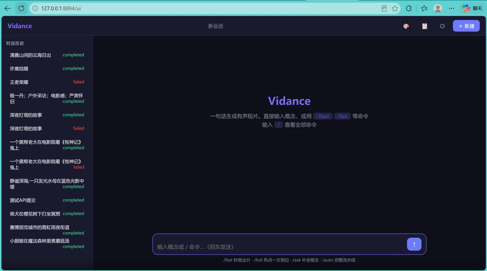 | 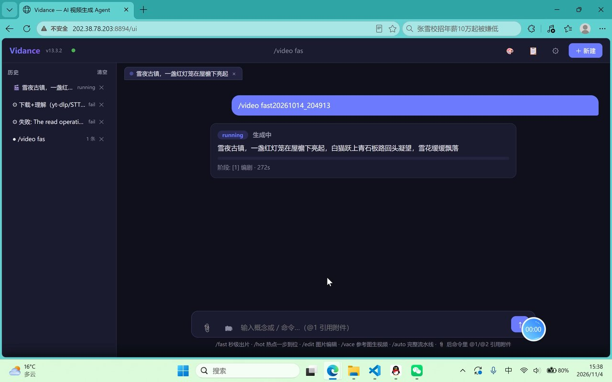 |
| **Natural-language chat to film** | **SAM2 editing (six-up comparison)** |
| 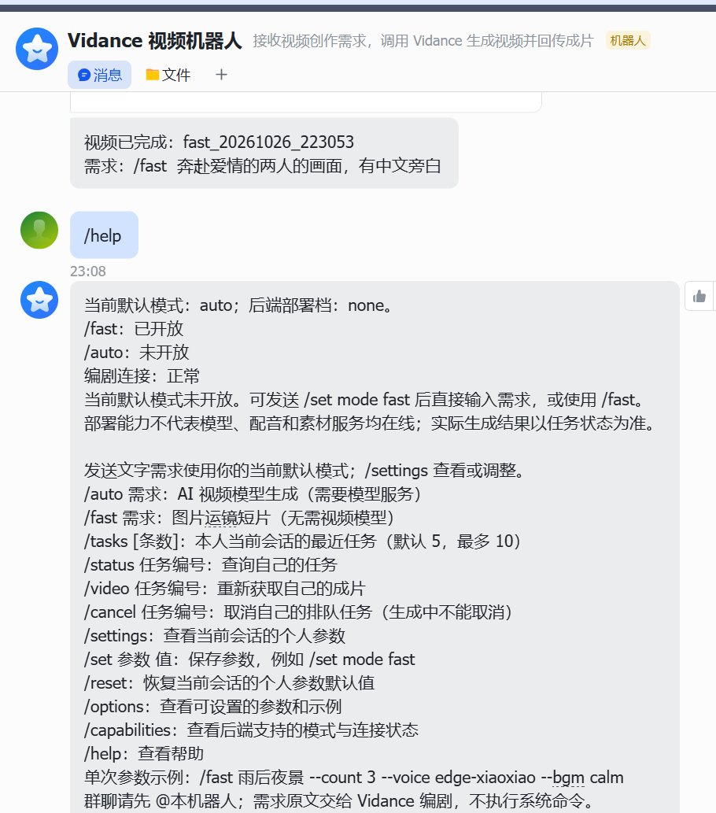 | 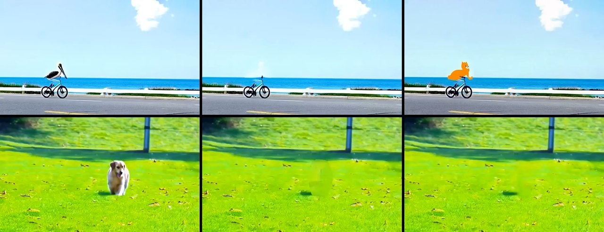 |

## 🧪 Quality

- 18 test suites, ~400 assertions, all green (run directly via `python tests/test_<name>.py`)
- **CI gate**: every push/PR runs the full suite in a clean environment (py3.10/py3.12, no GPU required)
- Key constraints automated: random seeds, per-shot ≤5s, duration alignment, Windows-compatible encoding (h264 + yuv420p explicit at every stage)
- Full metadata on disk (meta.json: script/prompts/seeds/review scores/timestamps); checkpoint resume with sha256 fingerprinting to catch tampered artifacts

## 📚 Documentation

| Doc | Contents |
|-----|----------|
| [docs/en/usage/usage.md](./docs/en/usage/usage.md) | Main user manual (quick start per tier + all commands) |
| [docs/en/roadmap.md](./docs/en/roadmap.md) | Full version history (v0→v22, all closed) |
| [CHANGELOG_EN.md](./CHANGELOG_EN.md) | Version changelog |
| [docs/en/deploy/README.md](./docs/en/deploy/README.md) | Deployment in depth (five tiers/Docker/offline images/GPU services) |
| [CONTRIBUTING.md](./CONTRIBUTING.md) | Contributing guide (setup/running tests/PR conventions) |
| [docs/design/](./docs/design/) | Per-version design docs (incl. architecture diagram source arch_v21.svg) |
| [docs/en/AGENTS.md](./docs/en/AGENTS.md) | Agent development conventions (internal) |

## 🔒 Configuration & Privacy

- `config/config.json` committed to the repo is a **placeholder template** (`YOUR_*_API_KEY`); real keys live in `config/config.local.json` (gitignored, read first automatically by the loader)
- First-time setup uses the `python core/vidance.py init` wizard; keys never appear in logs

## License

[Apache License 2.0](./LICENSE) — commercial use, modification, and closed-source redistribution permitted; contributor code carries an express patent grant.
